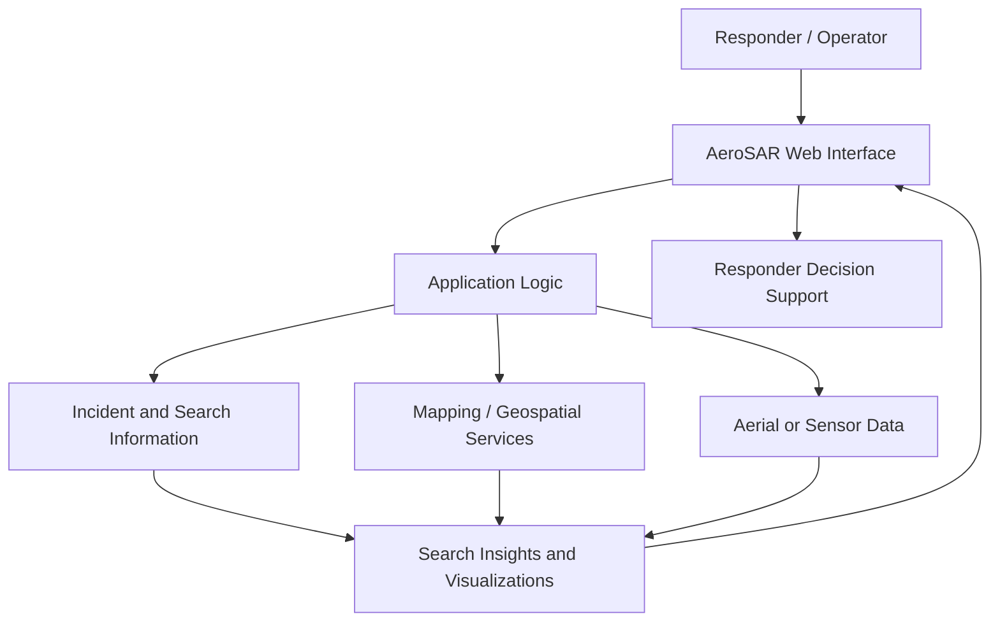

<div align="center">

# 🛩️ AEROSAR
### Aircraft Search & Rescue Intelligence

**A smarter approach to aerial search, disaster response, and rescue coordination.**

[](https://aerosar-aircraft-sea-nqax.bolt.host)
[](#)
[](#)

**Live Website:** https://aerosar-aircraft-sea-nqax.bolt.host

</div>

---

## 📌 Overview

**AeroSAR** is a search-and-rescue focused hackathon project exploring how digital tools and aerial intelligence can support emergency response. During disasters and other emergencies, finding people quickly and coordinating the response can be difficult because information may be incomplete, conditions may be dangerous, and time is limited.

AeroSAR aims to provide a clear digital interface for a more informed and coordinated search-and-rescue workflow. The project is being developed as part of **BST <> Protothon 2K26 — October Edition**.

> **Mission:** Help responders make faster, better-informed decisions when every minute matters.

🔗 **[Explore the live prototype](https://aerosar-aircraft-sea-nqax.bolt.host)**

## 🎯 Problem Statement

Search-and-rescue teams may face challenges such as:

- **Large search areas:** Locating people across difficult or remote terrain can take significant time.
- **Limited visibility:** Weather, darkness, smoke, water, and other environmental conditions can make searches harder.
- **Fragmented information:** Teams need a way to interpret available information and coordinate their next steps.
- **Time-sensitive decisions:** Delays in locating and assisting people can affect rescue outcomes.

AeroSAR explores a technology-assisted approach to making the search process more organized and actionable.

## 💡 Our Approach

AeroSAR is designed around the idea of bringing search-and-rescue information into one accessible interface. The long-term direction is to support a workflow in which operators can review relevant information, identify areas requiring attention, and coordinate search activity.

The exact capabilities available in the current prototype should be evaluated through the live demo; integrations and features that are not implemented should be treated as future work rather than operational capabilities.

## ✨ Key Features

Use this section to describe only the features that are actually working in your current build. The following are suitable feature areas for an AeroSAR project—remove or edit anything that your prototype does not implement.

- **🖥️ Search-and-rescue interface** — A central web interface for interacting with the AeroSAR prototype.
- **🗺️ Search-area visualization** — Display relevant locations or search areas if mapping is implemented.
- **🚁 Aerial search support** — Present information relevant to aerial search operations if this workflow is implemented.
- **📡 Situational awareness** — Help users interpret available incident or search information if supported.
- **📱 Accessible experience** — Make the interface usable across screen sizes, if responsive behavior has been tested.

## 🧭 How It Works

The intended high-level workflow is:

1. **Open the platform** — Visit the AeroSAR web application.
2. **Review available information** — Examine the incident, location, or other data exposed by the current prototype.
3. **Identify priorities** — Use the available interface and information to determine the next step.
4. **Support coordination** — Use the resulting information to support a more organized search-and-rescue workflow.

This describes the intended workflow, not a claim that every step is automated or currently implemented.

## 🏗️ System Architecture

The following diagram illustrates a **conceptual architecture** for an aerial search-and-rescue platform. Update it to match the actual components and integrations in this repository.



## 🧰 Technology Stack

The live prototype is hosted on Bolt. Confirm the exact frameworks and services from the source code before finalizing this table.

| Layer | Technology |
|---|---|
| Live prototype | [AeroSAR on Bolt](https://aerosar-aircraft-sea-nqax.bolt.host) |
| Frontend framework | Confirm from `package.json` |
| Styling and UI | Confirm from project dependencies |
| Backend / APIs | Add if implemented |
| Database | Add if implemented |
| AI / maps / external data | List only integrations actually used |
| Version control | Git and GitHub |

## 🖼️ Screenshots

Screenshots help reviewers understand the project quickly. Add images captured from the working application here.

Create a folder such as `docs/images/`, save screenshots in it, and then uncomment and update the examples below.

```md


```

## 🚀 Getting Started

### Try the live demo

No local installation is required to view the hosted prototype.

👉 **[Launch AeroSAR](https://aerosar-aircraft-sea-nqax.bolt.host)**

### Run locally

To run the project locally, first export or download the **source code** from Bolt and upload it to this repository. Then follow the instructions that match the actual project configuration.

For a typical Node.js project:

#### Prerequisites

- Node.js (use the version specified by the project)
- npm, pnpm, or the package manager indicated by the lockfile
- Environment variables or API credentials, if required

#### Installation

```bash
# 1. Clone your GitHub repository
git clone https://github.com/YOUR-USERNAME/YOUR-REPOSITORY.git

# 2. Enter the project directory
cd YOUR-REPOSITORY

# 3. Install dependencies (if package.json uses npm)
npm install

# 4. Start the development server (check package.json scripts)
npm run dev
```

Open the local address shown in your terminal.

> These commands are a starting template, not verified project-specific instructions. Check `package.json`, the lockfile, and any `.env.example` file before using them. If your project does not use Node.js, replace this section with the correct setup steps.

## 🧪 Current Status

AeroSAR is a **hackathon prototype**. The hosted demo demonstrates the current build; operational readiness, data accuracy, and real-world rescue performance have not been independently validated.

| Area | Status |
|---|---|
| Hosted demo | Available |
| Source-code setup | Add verified instructions after exporting source |
| Integrations | Document only those implemented |
| Real-world deployment | Not validated |

## 🛣️ Future Scope

Potential directions for future development, depending on the project goals:

- [ ] Improve incident and search-area visualization.
- [ ] Integrate verified geospatial or environmental data sources.
- [ ] Explore aerial imagery or sensor-data ingestion.
- [ ] Add role-based access and incident coordination tools.
- [ ] Improve accessibility, mobile responsiveness, and usability.
- [ ] Add automated tests, error handling, and deployment checks.
- [ ] Evaluate the system with domain experts before any real-world use.

## 👥 Team

Built for **BST <> Protothon 2K26 — October Edition**.

| Team Member | Role | GitHub |
|---|---|---|
| [Name] | [Role] | [GitHub profile] |
| [Name] | [Role] | [GitHub profile] |
| [Name] | [Role] | [GitHub profile] |
| [Name] | [Role] | [GitHub profile] |

Replace the example rows with your actual team members and responsibilities.

## 🤝 Contributing

Ideas and improvements are welcome.

1. Fork the repository.
2. Create a branch: `git checkout -b feature/your-feature`
3. Commit your changes: `git commit -m "Describe your change"`
4. Push your branch and open a Pull Request.

For a team hackathon repository, coordinate with the team before merging changes into the main branch.

## 🔐 Security & Responsible Use

- Never commit API keys, passwords, access tokens, or private credentials.
- Store secrets in environment variables and keep local `.env` files out of Git.
- Validate data received from external sources.
- Do not treat a prototype as a substitute for trained emergency responders or established emergency procedures.
- Any use in real rescue operations would require appropriate validation, testing, and operational oversight.

## 📄 License

No license has been specified yet. Add a `LICENSE` file and update this section if you intend to distribute the project under an open-source license.

---

<div align="center">

**Built with purpose. Designed around the urgency of search and rescue.**

### 🛩️ AeroSAR | BST <> Protothon 2K26

[Live Demo](https://aerosar-aircraft-sea-nqax.bolt.host) · [GitHub Repository](https://github.com/YOUR-USERNAME/YOUR-REPOSITORY)

</div>
